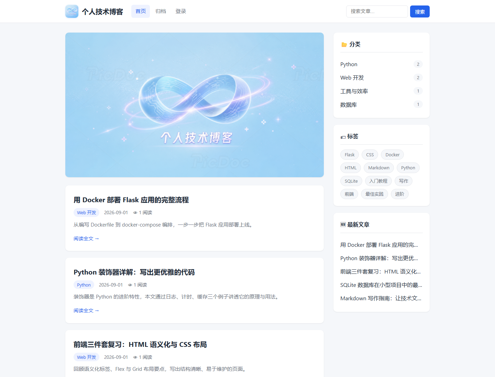

# 个人技术博客

基于 Flask + SQLite 的个人技术博客：前台提供文章浏览、分类标签、搜索与归档，后台提供文章与分类管理，文章详情页通过 CloudBase 云函数实现留言功能。



## 在线地址

| 版本 | 地址 | 说明 |
| --- | --- | --- |
| 静态交付版 | <https://blog-d3gd2wmcb82959ac9-1511513920.tcloudbaseapp.com/blog4/> | `freeze_static.py` 导出的纯静态站点（CloudBase 默认域名），可浏览文章、分类、标签、归档，支持前端索引搜索；不含后台与留言（留言区替换为提示），并附带 404 页 |
| 静态预览版 | <https://flask-tech-blog.app.workbuddy.host/?sharecode=4SZU3VKRDB> | 同一套 `freeze_static.py` 产物的在线预览，8 项上线检查清单在此实测通过 |
| 动态完整版 | <https://personal-tech-blog-10060.app.workbuddy.host/?sharecode=ZFCMKOTS27> | Flask 服务端实时渲染，功能完整；后台入口 `/login` |

## 功能列表

前台：

- 首页两套皮肤：`/`（浅色蓝紫风）与 `/v2`（深色科技风），数据完全一致，仅模板与样式不同
- 文章列表分页，每页 5 篇
- 文章详情：Markdown 渲染、阅读数统计、上一篇/下一篇、按标签关联的推荐阅读
- 分类筛选、标签筛选，均支持分页
- 关键词搜索：标题、摘要、正文三字段模糊匹配
- 归档页：按年份倒序分组展示全部文章
- 文章留言：Web SDK `callFunction` 调用云函数读写，匿名访客也可查看与发表

后台（需登录）：

- 仪表盘统计：文章数、分类数、标签数、总阅读量
- 文章新增、编辑、删除（Markdown 正文，逗号分隔标签自动创建）
- 新建分类
- 登录态基于 Flask session

工程能力：

- pytest 测试 72 条用例，全部通过
- `freeze_static.py` 静态化导出，供 CloudBase 静态网站托管
- Dockerfile 容器化部署（监听 `PORT` 环境变量，默认 8080）
- 微信小程序接入示例（`miniprogram/`，复用同一 CloudBase 环境）

## 技术栈与目录结构

| 层次 | 选型 |
| --- | --- |
| 后端 | Python 3.11 + Flask 3（路由、Jinja2 模板、session 登录保护） |
| 数据库 | SQLite（标准库 `sqlite3`，`Row` 工厂 + 外键约束，单文件 `database.db`） |
| 内容渲染 | `markdown` 3.x，启用 `fenced_code`、`tables`、`nl2br` 扩展 |
| 前端 | 原生 HTML / CSS / JavaScript，无框架、无构建步骤 |
| 留言云能力 | CloudBase PostgreSQL 表 `comments` + 云函数 `addComment`、`listComments`（Node.js 20）+ Web SDK 2.17.3 |
| 测试 | pytest 9（`pytest-cov` 已列为开发依赖，默认未启用覆盖率统计），临时库隔离 |
| 部署 | Docker / CloudBase 云托管；静态交付用 CloudBase 静态网站托管 |

目录结构：

```text
blog/
├── app.py                  # Flask 主应用：路由、分页、Markdown 过滤、登录保护
├── init_db.py              # 建表 SQL、种子数据、统一连接入口 create_connection()
├── database.db             # SQLite 数据库（本地文件，不入库；首次运行自动生成）
├── freeze_static.py        # 静态化导出脚本（生成可托管的扁平 HTML + 搜索索引）
├── templates/              # Jinja2 模板
│   ├── base.html           # 浅色版基础模板（含 scripts 插槽）
│   ├── base_v2.html        # 深色版基础模板
│   ├── index.html / index_v2.html
│   ├── article.html        # 文章详情（含留言区）
│   ├── category.html / tag.html / search.html / archives.html / 404.html / login.html
│   ├── _macros.html        # 分页、文章卡片宏
│   └── admin/              # 后台仪表盘与文章表单
├── static/
│   ├── css/style.css       # 浅色版样式（含留言区样式）
│   ├── css/style_v2.css    # 深色版样式
│   ├── js/comments.js      # 留言前端逻辑（匿名登录 + callFunction）
│   └── *.png               # Logo、Banner
├── cloudfunctions/
│   ├── addComment/         # 云函数：校验参数并写入 comments 表
│   └── listComments/       # 云函数：按文章 ID 读取最新 50 条留言
├── miniprogram/            # 微信小程序接入示例（wx.cloud.init 复用同一环境）
├── tests/                  # pytest：test_core.py / test_app.py / test_admin.py
├── docs/                   # 界面截图、小程序接入示例、AI 概念地图
├── dist/                   # 构建产物（静态站导出 / 云函数部署包），不入库
├── cloudbaserc.json        # CloudBase 云函数配置（含真实密钥，已被 .gitignore 排除，仅本地保留）
├── cloudbaserc.example.json# 上面文件的占位符模板，供他人参考
├── Dockerfile/.dockerignore
├── requirements.txt        # 生产依赖：flask、markdown
├── requirements-dev.txt    # 测试依赖：pytest、pytest-cov
├── pytest.ini
├── REFACTORING.md          # 重构说明（改了什么 / 为什么改 / 收益）
└── readme.txt              # 早期交付说明（保留备查）
```

## 本地运行方法

### 1. 直接运行 Flask

```powershell
cd "D:\Trae CN\lianxi\blog"
python -m venv .venv
.venv\Scripts\activate
pip install -r requirements.txt
python app.py
```

- 前台：<http://127.0.0.1:5000/>
- 深色版：<http://127.0.0.1:5000/v2>
- 后台：<http://127.0.0.1:5000/login>（默认账号 `admin` / `admin123`）

`app.py` 启动时会调用 `init_db.init_db()`：表不存在则建表，空库时写入 6 篇示例文章。`database.db` 为本地数据库、**不入库**（已被 `.gitignore` 排除），克隆后首次运行会自动重建，也可手动执行 `python init_db.py`。

### 2. 运行测试

```powershell
pip install -r requirements-dev.txt
pytest
```

测试通过 `tmp_path` 临时库 + `monkeypatch` 替换 `DB_PATH`，不会读写真实的 `database.db`；当前基线为 **72 passed**。

### 3. Docker 运行

```powershell
docker build -t blog .
docker run -p 8080:8080 -e PORT=8080 blog
```

容器内通过 `PORT` 环境变量监听 `0.0.0.0:8080`。

### 4. 静态站导出

```powershell
python freeze_static.py --out ../blog_static/blog4 --prefix /blog4
```

产物为扁平的 `.html` 文件、`search-index.json` 与 `static/`，上传到 CloudBase 静态托管的 `blog4/` 目录即可。

### 5. 留言功能配置（CloudBase）

1. 在 CloudBase 环境的 SQL 型数据库（PostgreSQL）中准备 `public.comments` 表，字段：`id`、`article_id`、`nickname`、`content`、`created_at`。
2. 部署两个普通云函数（执行方法 `index.main`，Node.js 20）：`addComment` 负责写入，`listComments` 负责读取。
3. 为两个云函数配置环境变量 `TCB_ENV_ID`、`TCB_API_KEY`（服务端 API Key，具备 `service_role` 权限，只能在控制台配置，**不要写进仓库**）。
4. 在「身份认证 → 登录方式」中开启匿名登录，供未登录访客读取留言。
5. 前端环境 ID 位于 `static/js/comments.js` 的 `ENV_ID`，如需切换环境请同步修改。

## 已知问题与后续计划

已知问题：

1. **演示级认证**：后台账号、密码与 `SECRET_KEY` 硬编码在 `app.py`，仅适合本地/教学演示，生产环境必须改为环境变量注入并做密码哈希。
2. **服务端密钥依赖**：云函数通过数据库网关读写 PostgreSQL，依赖控制台的 `TCB_API_KEY`（`service_role`，可绕过 RLS）。真实配置 `cloudbaserc.json` 已被 `.gitignore` 排除、只保留占位符模板 `cloudbaserc.example.json`，切勿把真实密钥提交进仓库。
3. **留言权限模型与文档差异**：当前环境为 PostgreSQL，没有「集合」概念，原始需求中的「仅创建者可写、所有人可读」落地为：客户端不持有数据库凭据、写入只能经云函数，读取经 `listComments` 开放给匿名访客。
4. **静态版功能受限**：静态交付版不含后台与留言（导出时会移除 CloudBase SDK 调用并替换为提示），搜索改为前端索引匹配。
5. **SQLite 持久化风险**：容器重新部署会重置镜像内数据，真实数据需外置或迁移到云数据库。
6. **留言治理缺失**：无删除、审核、频率限制，仅做长度校验（昵称 20 字、正文 500 字）。
7. **安全加固未完成**：未引入 CSRF 防护；演示账号密码为弱口令。
8. **测试覆盖边界**：70 条用例只覆盖 Flask 后端，云函数与前端留言逻辑没有自动化测试。

后续计划：

- 后台认证改为环境变量 + 密码哈希，移除硬编码凭据
- 留言增加管理端删除、审核开关与简单限频
- SQLite 迁移到 PostgreSQL / 云托管数据库，解决容器重建丢数据问题
- 补充云函数单测与前端留言的端到端测试
- 接入 CI（pytest + 静态检查），并在 README 中维护最新测试基线
