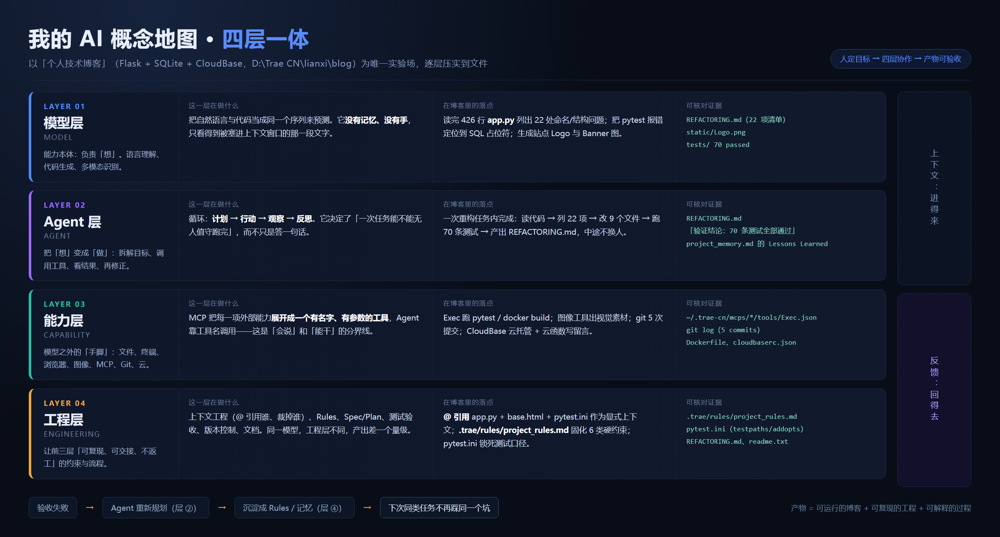
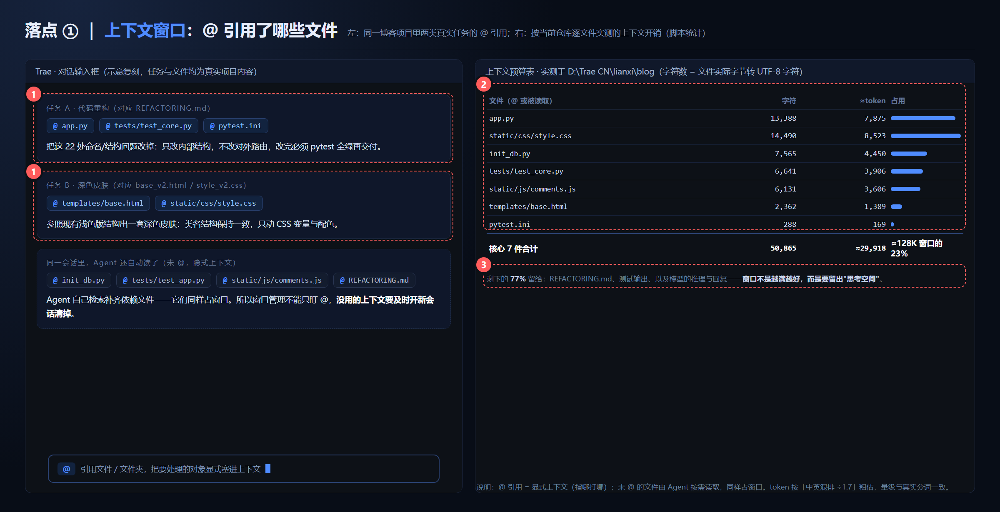
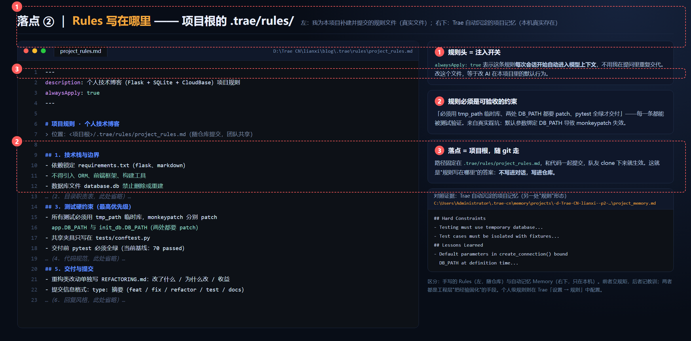
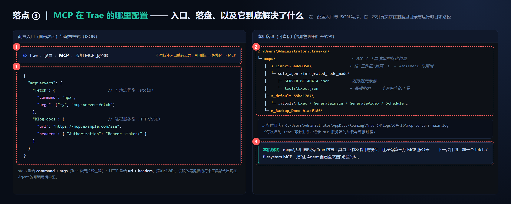

# 对照课程工具清单回顾：我的一张 AI 概念地图，和它在博客项目里的三处真实落点

> 实验场：`D:\Trae CN\lianxi\blog` —— 个人技术博客（Flask + SQLite + CloudBase 云托管）
> 方法：不背概念，逐层往自己的项目里"压"：每一层都要找到至少一个能用文件路径核对的落点。

---

## 一、先回顾：课程工具清单，我重新按"四层"摆了一遍

老师给的 AI 概念地图分四层：**模型层、Agent 层、能力层、工程层**。我把课程里出现过的工具按这个分层重新归位，并在右两列写上"我在博客项目里的真实用法"和"可核对证据"——归类不重要，落点才重要。

| 层 | 课程工具（按类别） | 我在博客项目里的用法 | 可核对证据 |
|---|---|---|---|
| 模型层 | 对话模型（可切换的内置模型）、图像生成模型 | 读 426 行 `app.py` 列出 22 处重构点；把 pytest 报错定位到 SQL 占位符；生成 Logo / Banner | `REFACTORING.md`（22 项清单）、`static/Logo.png` |
| Agent 层 | AI 编程助手（Trae）、Plan/Ask 模式、任务记忆 | 一次任务内完成：读代码 → 列 22 项 → 改 9 个文件 → 跑 70 条测试 → 写重构说明 | `REFACTORING.md`："验证结论：70 条测试全部通过" |
| 能力层 | 文件读写、终端执行、浏览器预览、MCP、Git、云部署 | Exec 跑 pytest / docker build；git 5 次提交；CloudBase 云托管 + 云函数留言板 | `~/.trae-cn/mcps/*/tools/Exec.json`、`Dockerfile`、`cloudbaserc.json`、`cloudfunctions/` |
| 工程层 | @ 上下文引用、Rules、测试框架、版本控制、部署 | `@` 引用核心文件；`.trae/rules/project_rules.md` 固化 6 类硬约束；`pytest.ini` 锁死测试口径 | `.trae/rules/project_rules.md`、`pytest.ini`、`.gitignore` |

**归位时发现的一个错位**：我原先把"MCP"当成一个独立工具来记，实际上它不属于任何一层——它是**能力层与 Agent 层之间的接口**（把外部能力展开成有名字的工具清单）。这就是重画地图的价值。

---

## 二、我自己的概念地图



用三句话说清层与层的关系（这是我自己的版本，不是照抄板书）：

1. **模型层只有"想"，没有"手"，也没有记忆。** 它只看得到被塞进上下文窗口的那段文字——所以**上下文窗口是模型层的生命线**，这也是落点①存在的原因。
2. **Agent 层把"想"变成"做"**：计划 → 行动 → 观察 → 反思的循环。重构任务能无人值守跑完，靠的是这个循环，不是模型更聪明。
3. **工程层决定下限**：同样一个模型，`@` 引用什么、Rules 写什么、测试怎么验收，产出能差一个量级。底部那条反馈回路是关键：**验收失败 → 重新规划 → 沉淀成 Rules**，下次同类任务不再踩同一个坑。

---

## 三、三处真实落点

### 落点 ①｜上下文窗口：@ 引用了哪些文件



- **Trae 里的位置**：对话输入框敲 `@`，弹出文件/文件夹选择器，选中的对象**显式注入**本次对话上下文。
- **博客里的真实引用**：重构任务引用 `app.py`、`tests/test_core.py`、`pytest.ini`；换深色皮肤任务引用 `templates/base.html`、`static/css/style.css`。这些文件都真实存在于仓库，体积是脚本逐个实测的。
- **自查数字**：核心 7 件合计约 5.1 万字符 ≈ 3 万 token，占 128K 窗口约 23%。**窗口不是越满越好**——剩下 77% 要留给测试输出和模型的推理空间。
- **一个容易忽略的点**：没被 `@` 的文件（`init_db.py`、`comments.js`）会被 Agent 按需自动读取，**同样占窗口**。所以任务做完开新会话清窗口，是省 token 的第一习惯。

### 落点 ②｜Rules 写在哪里



- **标准答案**：项目级规则写在**项目根目录** `.trae/rules/project_rules.md`，随 git 提交、队友 clone 即生效；个人级规则在 Trae「设置 → 规则」里配置，只影响本机。
- **诚实声明**：排查时我发现本仓库此前**没有**这个文件——规则只以两种"野生形态"存在：Trae 自动沉淀的项目记忆（`~/.trae-cn/memory/projects/-d-Trae-CN-lianxi--p2-…/project_memory.md`，里面有 Hard Constraints / Lessons Learned），以及 `pytest.ini` + `tests/conftest.py` 里的硬约束。**本次实验我把它补建了**：内容不是编的，每一条都来自真实踩坑——比如"monkeypatch 必须同时 patch `app.DB_PATH` 和 `init_db.DB_PATH`"就是重构时真实翻过的车。
- **我的体会**：Rules 和 Memory 的分工——**手写的 Rules 立规矩（可验收的约束），自动的 Memory 记教训（已经踩过的坑）**。规则必须是"能被测试验证的句子"，"代码要规范"这种口号写了等于没写。

### 落点 ③｜MCP 在 Trae 的哪里配置



- **配置入口**：Trae「设置 → MCP → 添加 MCP 服务器」（不同版本入口略有差异：AI 侧栏 → 智能体 → MCP）。
- **配置格式**：本地进程型（stdio）写 `command + args`；远程服务型写 `url + headers`。
- **本机落盘**：`C:\Users\Administrator\.trae-cn\mcps\`，按工作区作用域隔离（`s_lianxi-*` 就是本项目那次会话的作用域），里面 `SERVER_METADATA.json` + `tools/*.json` 就是"能力被展开成工具清单"的直接证据；运行时日志在 `%APPDATA%\Trae CN\logs\<会话>\mcp-servers-main.log`。
- **本机现状（也诚实写）**：目前 `mcps\` 里只有 Trae 内置工具与作用域缓存，**还没有添加第三方 MCP 服务器**。下一步：加一个 fetch / filesystem MCP，把"让 Agent 自己查文档"跑通闭环——这一步做完，能力层才算真正点亮。

---

## 四、收尾：三句话总结

1. 概念地图画一次没用，**每一层都必须压出一个文件路径**，否则只是抄板书。
2. 三处落点里最有价值的是落点②的"发现空白"：Rules 没配置本身就是发现——**工程层的欠账，补上就是本次实验最大的产出**。
3. 下一站：给 Trae 配一个真实的 MCP 服务器，把能力层和 Agent 层的接口亲手接一次。

## 附：任何人都能复现的核对清单

```bash
# 落点①：统计核心文件的上下文开销
cd "D:\Trae CN\lianxi\blog" && python -c "print(sum(len(open(f,'rb').read()) for f in ['app.py','static/css/style.css','init_db.py','tests/test_core.py','static/js/comments.js','templates/base.html','pytest.ini']))"
# → 50865 字符 ≈ 3 万 token

# 落点②：确认规则文件存在
type "D:\Trae CN\lianxi\blog\.trae\rules\project_rules.md"

# 落点③：确认 MCP 落盘目录
dir "C:\Users\Administrator\.trae-cn\mcps"
```

> 说明：图 2 左侧的对话输入区为示意复刻（任务与文件均为本项目真实内容，体积为实测）；图 3 中的规则文件为本次实验补建并已随项目保存。
